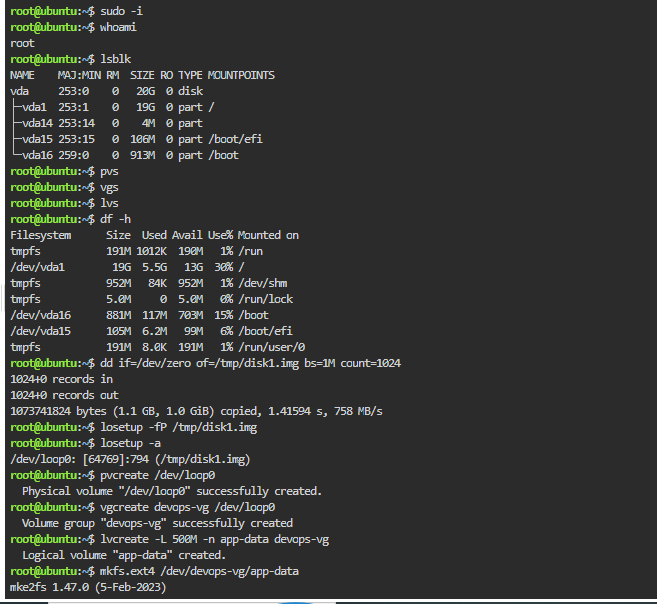
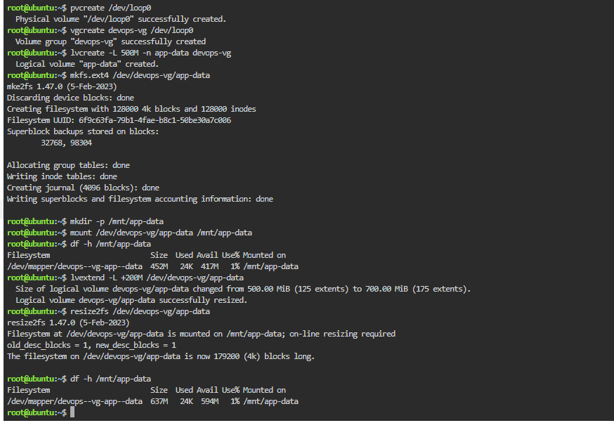

# Day 13 – Linux Volume Management (LVM)

## Objective

Learn Linux Logical Volume Management (LVM) by creating a virtual disk, configuring Physical Volumes, Volume Groups, Logical Volumes, formatting, mounting, and extending storage.

## Environment

- Operating System: Ubuntu
- User: root
- Virtual Disk Image: `/tmp/disk1.img`
- Loop Device: `/dev/loop0`
- Volume Group: `devops-vg`
- Logical Volume: `app-data`
- Filesystem: ext4
- Mount Point: `/mnt/app-data`

---

## Task 1: Check Current Storage

### Commands Used

```bash
sudo -i
whoami
lsblk
pvs
vgs
lvs
df -h
```

### Observations

- Verified root user access.
- Checked available disks and partitions using `lsblk`.
- Checked existing Physical Volumes using `pvs`.
- Checked existing Volume Groups using `vgs`.
- Checked existing Logical Volumes using `lvs`.
- Checked filesystem storage using `df -h`.

No existing LVM Physical Volumes, Volume Groups, or Logical Volumes were present.

## Task 2: Create Physical Volume

Since no spare disk was available, I created a 1 GB virtual disk using a disk image and loop device.

### Commands Used

```bash
dd if=/dev/zero of=/tmp/disk1.img bs=1M count=1024

losetup -fP /tmp/disk1.img

losetup -a

pvcreate /dev/loop0
```

### Result

- Created a 1 GB virtual disk image.
- Attached the disk image to `/dev/loop0`.
- Successfully initialized `/dev/loop0` as an LVM Physical Volume.

Output:

```text
Physical volume "/dev/loop0" successfully created.
```

## Task 3: Create Volume Group

### Command Used

```bash
vgcreate devops-vg /dev/loop0
```

### Result

Successfully created the Volume Group `devops-vg` using the Physical Volume `/dev/loop0`.

## Task 4: Create Logical Volume

### Command Used

```bash
lvcreate -L 500M -n app-data devops-vg
```

### Result

Successfully created a 500 MB Logical Volume named `app-data` inside `devops-vg`.

Output:

```text
Logical volume "app-data" created.
```

## Task 5: Format and Mount

### Commands Used

```bash
mkfs.ext4 /dev/devops-vg/app-data

mkdir -p /mnt/app-data

mount /dev/devops-vg/app-data /mnt/app-data

df -h /mnt/app-data
```

### Result

- Created an ext4 filesystem on the Logical Volume.
- Created the mount directory `/mnt/app-data`.
- Successfully mounted the Logical Volume.
- Verified the mounted filesystem using `df -h`.

Initial filesystem size: 452 MB

## Task 6: Extend the Volume

### Commands Used

```bash
lvextend -L +200M /dev/devops-vg/app-data

resize2fs /dev/devops-vg/app-data

df -h /mnt/app-data
```

### Result

- Extended the Logical Volume from 500 MB to 700 MB.
- Successfully resized the ext4 filesystem.
- Performed online filesystem resizing while the volume was mounted.
- Verified the updated storage capacity.

Final output:

```text
Filesystem                        Size  Used Avail Use% Mounted on
/dev/mapper/devops--vg-app--data  637M   24K  594M   1% /mnt/app-data
```

The final usable filesystem size was 637 MB.

---

## What I Learned

1. Learned how to create virtual disks and configure LVM Physical Volumes and Volume Groups.
2. Learned how to create, format, and mount Logical Volumes using the ext4 filesystem.
3. Learned how to extend Logical Volumes and resize filesystems without unmounting them.

## Conclusion

Successfully completed all 6 tasks of Day 13 – Linux Volume Management (LVM).

Created a virtual disk, configured Physical Volumes, Volume Groups and Logical Volumes, formatted and mounted storage, and extended the Logical Volume from 500 MB to 700 MB.

---

## Screenshots

### Screenshot 1 – Storage Check and LVM Setup



### Screenshot 2 – LVM Formatting, Mounting and Volume Extension



**Status: Completed Successfully.**

#90DaysOfDevOps #DevOpsKaJosh #TrainWithShubham